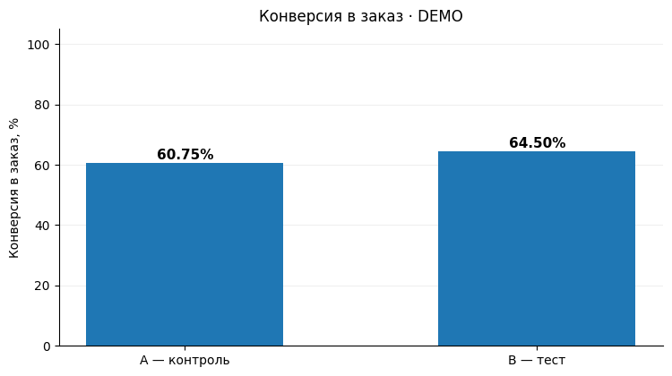

# A/B-тест: влияние варианта B на конверсию в заказ

**Учебный аналитический проект · Product Analyst / Data Analyst**  
`Python` · `pandas` · `SciPy` · `statsmodels` · `A/B Testing` · `Data Validation` · `Segmentation`

## Бизнес-задача

Стоит ли масштабировать вариант B? Для первичной оценки сравниваем долю просмотров с заказом в группах A и B. В учебном задании описание варианта B отсутствует, поэтому наблюдаемую разницу можно связать только с назначенной группой.

## Данные и метод

Одна строка соответствует просмотру (`id_view`). В таблице есть время просмотра, группа A/B, город и бинарный признак заказа. Конверсия рассчитывается как число просмотров с заказом, делённое на число просмотров в группе.

1. Проверка пропусков, уникальности `id_view`, бинарных значений и соответствия справочнику городов.
2. Диагностика Sample Ratio Mismatch (SRM) при предполагаемом сплите 50/50.
3. Двусторонний z-тест двух долей и 95% доверительный интервал Ньюкомба для разницы B − A.
4. Исследовательские разрезы по городам и времени суток. Для городских сравнений применяется поправка Холма.

## Результаты на исходных учебных данных

| Показатель | Контроль A | Тест B |
|---|---:|---:|
| Наблюдения (`id_view`) | 10 826 | 11 113 |
| Заказы (`nflag_order = 1`) | 6 659 | 7 510 |
| Конверсия | 61,51% | 67,58% |

- **Абсолютная разница (B − A): +6,07 процентного пункта**.
- **Относительная разница: +9,87%** к конверсии контроля.
- **95% ДИ разницы:** [+4,80; +7,33] п.п. (метод Ньюкомба).
- **Двусторонний z-тест:** p ≈ 5,59 × 10⁻²¹.
- **Города:** после поправки Холма статистически значимые различия в Москве, Санкт-Петербурге и Казани (исследовательский анализ).
- **SRM при предполагаемом распределении 50/50:** p ≈ 0,0527 — на уровне 0,05 формального сигнала нет, но результат близок к порогу и требует подтверждения плановых долей.

**Интерпретация:** в предоставленных данных тестовая группа имеет более высокую конверсию. Но эти результаты **не являются достаточным основанием для безусловного rollout**: `id_view` не заменяет `user_id`, поэтому нельзя проверить уникальность пользователей, независимость событий и единицу рандомизации. Также не предоставлены показатели дохода и защитные метрики.

> Цифры выше рассчитаны на оригинальном учебном Excel, который **не включён в публичный репозиторий**. Демо-набор ниже — полностью синтетический, его результаты **другие** и не должны смешиваться с оригинальными.

## Визуализация на синтетических данных



*Здесь показан только демонстрационный набор, не исходный учебный эксперимент.*

## Структура

```text
.
├── README.md
├── notebooks/
│   └── ab_test_conversion.ipynb     # Ноутбук с анализом (по умолчанию demo)
├── src/
│   ├── analysis.py                 # Проверки, метрики, статистика
│   └── generate_demo_data.py       # Воспроизводимый генератор синтетики
├── data/
│   └── demo/
│       ├── events.csv              # Только синтетические данные
│       └── cities.csv
├── docs/
│   └── original_results_summary.md # Сводные результаты исходного задания
├── tests/
│   └── test_analysis.py
├── requirements.txt
└── .gitignore                       # Исходный Excel не публикуется
```

## Как воспроизвести

1. Установить Python 3.10+ и зависимости: `python -m pip install -r requirements.txt`.
2. При необходимости пересоздать **только синтетические** данные: `python -m src.generate_demo_data`.
3. Выполнить тесты: `python -m unittest discover -s tests`.
4. Открыть `notebooks/ab_test_conversion.ipynb` с помощью `jupyter lab` и запустить все ячейки.
5. По умолчанию стоит `DATA_MODE = 'demo'`, поэтому ноутбук запустится **без** оригинального Excel.

Для работы с исходными данными: положить файл `Финальная первичная аттестация. Вариант 1. Python.xlsx` в локальную папку `data/private/` и переключить `DATA_MODE = 'original'`. Не коммитить файл или производные построчные наборы в открытый репозиторий без разрешения правообладателя.

## Рекомендация продуктовой команде

Перед масштабированием B подтвердить дизайн эксперимента и оценить эффект на уровне единицы рандомизации. Если дизайн нельзя восстановить, запустить повторный тест с заранее заданными метриками и критериями внедрения.

- Проверить план эксперимента, способ назначения A/B и единицу рандомизации; при повторных просмотрах одного пользователя анализировать на уровне пользователя или использовать корректную кластеризацию.
- Уточнить бизнес-смысл заказа, стоимость изменения, метрики выручки и guardrail-метрики.
- Зафиксировать первичную метрику и сегменты до эксперимента; при сравнении сегментов оценить взаимодействие, не делать выводы по разнице статистических значимостей.
- Если эксперимент последовательный или имел промежуточные остановки, скорректировать статистическую процедуру под дизайн.
